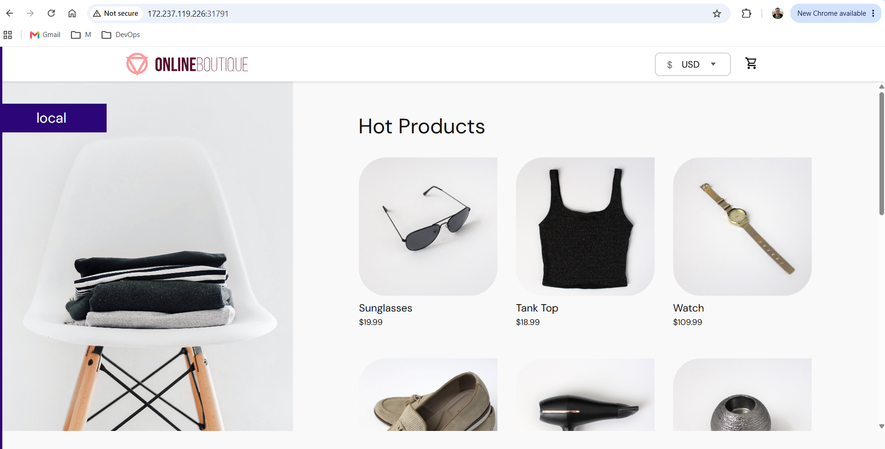
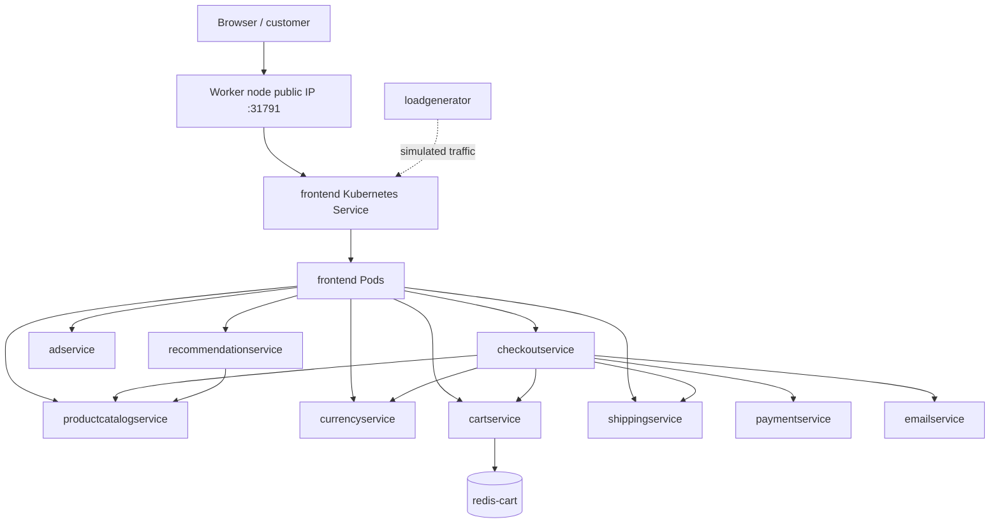

### Online Boutique Microservices on Linode Kubernetes Engine

> **Project status:** Storefront reachable from three LKE worker-node IP addresses through Kubernetes NodePort `31791` (verified 20 November 2026). End-to-end checkout, service health, and Helm release state still require separate verification.

#### Project overview

This project deploys **Online Boutique**, Google's sample microservices e-commerce application, to **Linode Kubernetes Engine (LKE)**. The deployment demonstrates how Kubernetes runs and connects independently deployed application components, and how a storefront can be exposed externally through a Kubernetes Service.

**Cluster:** `online-shop-microservices` (LKE cluster ID `650941`)  
**Source configuration:** `config.yaml` 
**Additional Helm configuration:** `email-service-values.yaml`



*Deployment evidence: the Online Boutique storefront loaded via a worker node's public IP and NodePort `31791`. Screenshot captured on 20 November 2026.*

#### Business problem and engineering value

An e-commerce application has distinct responsibilities: product discovery, cart management, checkout, payments, shipping, recommendations, and more. Packaging all responsibilities into one deployable unit can make independent updates and scaling difficult.

This demonstration explores a microservices architecture in which each component runs as its own Kubernetes workload and communicates with other services over Kubernetes networking. It highlights the operational skills needed to deploy, connect, expose, and troubleshoot a multi-component application on managed cloud infrastructure.

#### Architecture



*Simplified logical diagram based on the provided Kubernetes manifest and application overview; it does not assert that every service is currently healthy.*

#### Application components

| Component | Purpose |
| --- | --- |
| `frontend` | Web storefront and user interaction |
| `productcatalogservice` | Product catalogue |
| `cartservice` | Shopping cart functionality |
| `redis-cart` | Cart data cache/store |
| `currencyservice` | Currency conversion |
| `checkoutservice` | Checkout orchestration |
| `paymentservice` | Simulated payment processing |
| `shippingservice` | Shipping calculations |
| `emailservice` | Order confirmation emails |
| `recommendationservice` | Product suggestions |
| `adservice` | Advertising content |
| `loadgenerator` | Synthetic customer traffic; present in the application overview, not established as deployed by the supplied manifest |

#### Technologies

- **Cloud:** Linode Kubernetes Engine (LKE)
- **Orchestration:** Kubernetes Deployments, Services, Pods, health probes, replica settings
- **Application:** Google Online Boutique microservices demo (`v0.8.0` images in the supplied manifest)
- **Networking:** ClusterIP services and externally tested NodePort
- **Configuration:** YAML manifests and Helm-style values for the email service
- **Data:** Redis for shopping cart functionality
- **Tooling:** `kubectl`, Windows PowerShell, VS Code, Git, GitHub

#### Repository layout

```text
kubernetes-online-boutique-microservices/
├── README.md
├── config.yaml           # Multi-service Kubernetes manifest
├── email-service-values.yaml      # Helm values for emailservice
└── assets/
    └── online-boutique-storefront.png
```

**Note:** `config.yaml` is a collection of Kubernetes resource manifests, **not** a Helm chart. `email-service-values.yaml` contains values that can be supplied to a compatible Helm chart; its presence alone does not prove that a Helm release has been installed.

#### Deployment and configuration

#### 1. Select the LKE cluster

Keep the downloaded administrator kubeconfig **outside the Git repository** wherever possible. If it is stored locally in the project for development, exclude it from Git and restrict file permissions.

```powershell
$env:KUBECONFIG = (Resolve-Path ".\online-shop-microservices-kubeconfig.yaml").Path
kubectl config current-context
kubectl get nodes -o wide
```

Expected context for this demo: `lke650941-ctx`. Do not publish kubeconfig content or authentication tokens.

#### 2. Inspect or apply the Kubernetes manifest

From the project directory:

```powershell
kubectl apply --dry-run=client -f .\online-boutique.yaml
kubectl apply -f .\online-boutique.yaml
```

Only apply the manifest if you intend to create or reconcile these resources in the **selected cluster**. Inspect the YAML and current workloads first to avoid unintentionally replacing an existing configuration.

The supplied manifest defines multiple Deployments and Services. It uses Kubernetes DNS names such as `productcatalogservice:3550` and `redis-cart:6379` for service-to-service communication. The `frontend` Service in that supplied manifest is declared as `LoadBalancer`; the working NodePort `31791` shown in the browser is a **runtime observation**, so confirm the actual live Service type and allocated ports before treating the manifest as an exact snapshot of the cluster.

#### 3. Inspect Helm configuration

The supplied `email-service-values.yaml` specifies:

```yaml
appName: emailservice
appImage: gcr.io/google-samples/microservices-demo/emailservice
appVersion: v0.8.0
appReplicas: 2
containerPort: 8080
containerEnvVars:
  - name: PORT
    value: "8080"
servicePort: 5000
```

Verify Helm release state before documenting a successful Helm deployment:

```powershell
helm list -A
```

A chart directory and the actual Helm install/upgrade command should be recorded when that part of the lesson is complete.

#### Verification and observed results

#### Confirmed: storefront access from three worker nodes

On 20 November 2026, the storefront was successfully opened through the following worker-node addresses:

| Worker node public IP | Test URL | Observed result |
| --- | --- | --- |
| `172.237.119.226` | `http://172.237.119.226:31791/` | Storefront accessible (reported) |
| `172.237.112.121` | `http://172.237.112.121:31791/` | Storefront accessible (reported) |
| `172.239.120.174` | `http://172.239.120.174:31791/` | Storefront accessible (reported) |

These are **temporary learning/demo endpoints**, not stable production URLs. Node IPs and allocated NodePorts can change. The screenshot shows an HTTP connection without TLS.

#### Recommended checks before marking the project complete

```powershell
kubectl get nodes -o wide
kubectl get deployments -A
kubectl get pods -A -o wide
kubectl get services -A -o wide
kubectl get events -A --sort-by=.lastTimestamp
helm list -A
```

For a failing service (replace the namespace if necessary):

```powershell
kubectl describe pod <pod-name>
kubectl logs <pod-name> --all-containers=true --previous
```

Test the product catalogue, cart, currency selector, checkout, and order flow separately. A working home page does not by itself prove that all back-end dependencies are healthy.

#### Troubleshooting log

| Observation | Engineering significance | Follow-up |
| --- | --- | --- |
| Online Boutique page loads through NodePort `31791` on three LKE worker-node addresses | External Kubernetes service routing is functioning for the storefront | Save screenshot and record live Service type/ports |
| `emailservice` previously reported `CrashLoopBackOff` in an earlier cluster inspection | A healthy storefront does not necessarily imply that checkout email delivery is working | Inspect current pod status, `describe`, and current/previous logs; document actual cause and resolution only after verification |
| Browser reports **Not secure** for the HTTP endpoint | Traffic is not protected by HTTPS | Use an Ingress/load balancer and TLS for production-like exposure |

#### Security and operational considerations

- **Never commit** kubeconfig files, tokens, credentials, or private keys. Add `**/*kubeconfig*.yaml` to the repository `.gitignore` and verify that Git is not tracking the file.
- A previously shared administrator kubeconfig should be treated as exposed; arrange credential rotation through the cloud provider. Downloading a new file does not necessarily revoke the old token.
- The demonstrated endpoint uses **HTTP** and public worker-node IPs. For a production-like setup, use TLS, a stable hostname, and appropriately restricted ingress.
- Configure resource requests and limits consistently, and validate readiness/liveness probes across services.
- Review worker-node, NodeBalancer, and storage charges in Linode Cloud Manager. **Keep the Online Boutique cluster while actively working on the demo**, and delete billable resources only after documentation and any required backups are complete.
- The supplied Redis manifest uses `emptyDir`, which is ephemeral storage; do not treat it as durable production cart storage.

#### Next improvements

1. Capture `kubectl get pods`, `kubectl get svc`, and `helm list -A` evidence.
2. Diagnose and resolve any remaining `emailservice` errors.
3. Confirm cart and checkout workflows end to end.
4. Record Helm chart structure and actual release commands if Helm is used in subsequent lessons.
5. Add an Ingress with TLS and a stable hostname.
6. Add monitoring, logs, resource tuning, and repeatable deployment automation.
7. Remove cloud resources when the demo is complete to avoid ongoing costs.

#### Learning outcomes

- Deploy and operate a multi-service application on a managed Kubernetes cluster.
- Understand service discovery and communication between Kubernetes workloads.
- Verify external access through Kubernetes networking.
- Distinguish application availability from full service health.
- Document operational evidence, troubleshooting, and security limitations transparently.

---

**Portfolio context:** Part of a hands-on DevOps learning portfolio covering CI/CD, cloud infrastructure, containerisation, Kubernetes, Helm, and future infrastructure automation and observability.
