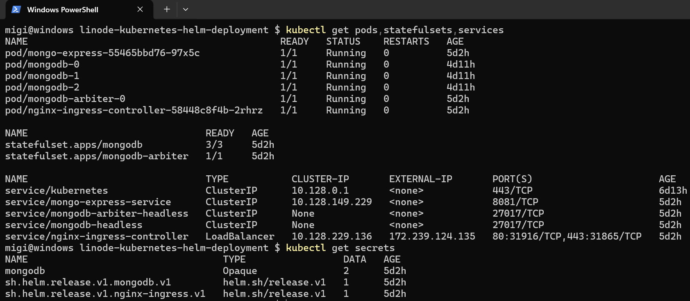
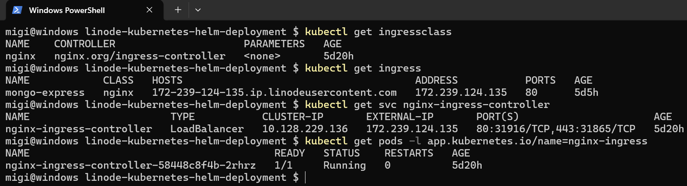
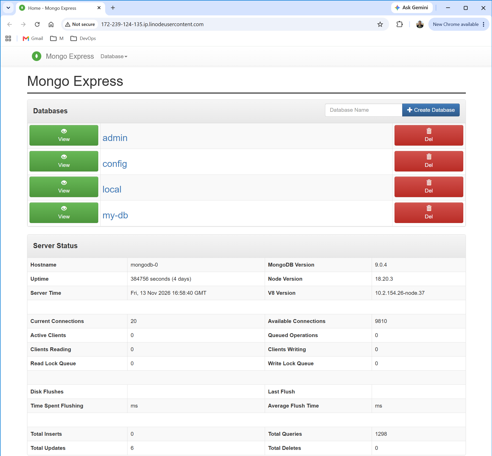

### Managed Kubernetes & Helm Deployment on Linode (LKE)

Deploying a MongoDB replica set and Mongo Express on a managed Linode Kubernetes Engine (LKE) cluster, with Helm, persistent storage, Kubernetes networking, and an NGINX Ingress Controller.

#### Project overview

This hands-on project demonstrates how a managed Kubernetes cluster can host a stateful database alongside a web-based administration interface. MongoDB is installed using a Helm chart, while Mongo Express and its Service and Ingress are defined with Kubernetes manifests.

**What this project demonstrates:** managed Kubernetes, Helm release management, StatefulSets, persistent storage, Kubernetes Secrets, internal Services, Ingress routing, and troubleshooting cloud load-balancer health.

> **Scope:** A learning and portfolio demonstration, not a production-hardened database deployment. Do not expose Mongo Express publicly without appropriate access controls, authentication, and TLS.

#### Architecture

```text
Browser (HTTP request with configured Host header)
    |
    v
Linode NodeBalancer (external IP)
    |
    v
NGINX Ingress Controller
    |
    v
Ingress: mongo-express
    |
    v
Service: mongo-express-service :8081
    |
    v
Mongo Express Deployment (1 replica)
    |
    v
MongoDB headless Service / replica set
    |-- mongodb-0
    |-- mongodb-1
    |-- mongodb-2
    `-- mongodb-arbiter-0 (elections; no database storage)

MongoDB database members use persistent volumes provisioned through Linode Block Storage.
```

#### Technologies

| Technology | Role |
|---|---|
| Linode Kubernetes Engine (LKE) | Managed Kubernetes cluster |
| Kubernetes / kubectl | Deploy and inspect cluster resources |
| Helm | Install and manage MongoDB and NGINX Ingress Controller charts |
| MongoDB | Stateful replica-set database |
| Mongo Express | Browser-based MongoDB administration interface |
| NGINX Ingress Controller | HTTP request routing |
| Linode NodeBalancer | External traffic entry point |
| Linode Block Storage | Persistent volumes for MongoDB |
| PowerShell | Local CLI workflow on Windows |

#### Repository files

```text
linode-kubernetes-helm-deployment/
├── README.md
├── helm-mongodb.yaml         # Helm values for MongoDB
├── helm-mongo-express.yaml   # Deployment and ClusterIP Service
├── helm-ingress.yaml         # Ingress routing rule
└── assets/                   # Verification screenshots
```

The local `test-kubeconfig.yaml` is deliberately excluded from version control. It contains cluster access credentials and must not be published.

#### Implementation

#### 1. Configure cluster access

Download the kubeconfig from LKE, store it securely, and set `KUBECONFIG` in PowerShell:

```powershell
$env:KUBECONFIG = (Resolve-Path ".\test-kubeconfig.yaml").Path
kubectl config current-context
kubectl get nodes
```

The relative path above assumes a local, Git-ignored kubeconfig in the project directory. In other setups, use an absolute path outside the repository.

#### 2. Deploy MongoDB with Helm

The `helm-mongodb.yaml` values specify a replica-set architecture, three database replicas, and the `linode-block-storage` StorageClass. Supply the MongoDB root password securely at deployment time rather than committing it in the values file.

```powershell
helm repo add bitnami https://charts.bitnami.com/bitnami
helm repo update bitnami
helm search repo bitnami/mongodb
```

Chart versions and availability can change; verify the chart compatible with your Kubernetes version before installing. Install with a securely supplied password using the chart's supported authentication settings.

Verify the installed release and resources:

```powershell
helm list
kubectl get pods
kubectl get statefulsets
kubectl get pvc
kubectl get services
```

**Observed result:** `mongodb-0`, `mongodb-1`, `mongodb-2`, and `mongodb-arbiter-0` reached `1/1 Running`; the MongoDB StatefulSet reached `3/3` ready.

#### 3. Deploy Mongo Express

The `helm-mongo-express.yaml` manifest defines a Deployment and internal ClusterIP Service on port `8081`. Mongo Express obtains its database password through the Kubernetes Secret named `mongodb`, using the key `mongodb-root-password`.

```powershell
kubectl apply -f .\helm-mongo-express.yaml
kubectl get deployment mongo-express
kubectl get service mongo-express-service
```

For a private local test:

```powershell
kubectl port-forward service/mongo-express-service 8081:8081
```

Open `http://localhost:8081` while the port-forward is running.

#### 4. Install NGINX Ingress Controller

This project uses the NGINX Ingress Controller OCI Helm chart (the `nginx.org/ingress-controller` implementation, not the separate community `ingress-nginx` chart).

```powershell
helm install nginx-ingress oci://ghcr.io/nginx/charts/nginx-ingress `
  --set controller.reportIngressStatus.enable=true

kubectl get ingressclass
kubectl get pods
kubectl get service nginx-ingress-controller
```

The controller was installed successfully, and the `nginx` IngressClass was available. The LoadBalancer Service received an external Linode NodeBalancer IP.

#### 5. Configure the Ingress route

The `helm-ingress.yaml` manifest routes requests with the configured Linode hostname to `mongo-express-service:8081`:

```powershell
kubectl apply -f .\helm-ingress.yaml
kubectl get ingress
kubectl describe ingress mongo-express
```

The hostname in the manifest is specific to this temporary cloud deployment. Update it for a newly provisioned NodeBalancer. A hostname-based Ingress rule requires the incoming request's `Host` header to match.

#### Verification evidence

| Check | Observed outcome |
|---|---|
| MongoDB database pods | Three members running |
| MongoDB arbiter | Running |
| MongoDB StatefulSet | `3/3` ready |
| Mongo Express Deployment | `1/1` ready |
| NGINX controller | `1/1` running |
| IngressClass | `nginx` |
| Linode NodeBalancer | External IP assigned; application access verified |

#### Screenshots



- `mongodb-helm-resources.png` — MongoDB pods, StatefulSets, Services, and Secret names (not Secret values).



- `nginx-ingress-loadbalancer.png` — Ingress Controller and external LoadBalancer address.



- `mongo-express-browser.png` — Working application UI, with sensitive content removed.

#### Troubleshooting and lessons learned

#### Helm repository index missing

Helm reported a missing Bitnami repository index despite the repository being registered. Refreshing its cache with `helm repo update bitnami` is the first troubleshooting step. This is a local Helm catalogue issue, not evidence that the Kubernetes cluster is corrupt.

#### StatefulSet pods appeared sequentially

During initial deployment, `mongodb-2` was not immediately visible and `mongodb-1` was not yet ready. The expected three database pods and arbiter subsequently reached `Running`. StatefulSet ordering and readiness can explain this initial difference.

#### NodeBalancer reported `2 Up / 2 Down`

The Linode NodeBalancer showed one healthy and one unhealthy backend for each of ports 80 and 443. The NGINX LoadBalancer Service was configured with `ExternalTrafficPolicy: Local`, and one controller replica was running. A likely explanation is that only the worker node hosting the controller had a local endpoint; traffic to the other node was not forwarded across nodes. Confirming the controller's node placement with `kubectl get pods -o wide` would establish the cause. The application was subsequently reported working.

#### Security and operational considerations

- Keep kubeconfig files, tokens, and real database passwords out of Git; `.gitignore` does not remove secrets from earlier commits.
- Do not publish a real MongoDB root password in `helm-mongodb.yaml`. Use secure credential management and rotate credentials exposed publicly.
- Mongo Express is an administrative interface. Prefer private access or protect public access with TLS, strong authentication, and network restrictions.
- Pin tested image and chart versions for reproducible deployments.
- Monitor Linode cluster, NodeBalancer, and persistent-volume costs; delete demo infrastructure when no longer needed.

#### Future improvements

- Add HTTPS and access restrictions for the Ingress endpoint.
- Move database credentials to a managed secret workflow.
- Pin and test Helm chart and container image versions.
- Introduce resource requests, limits, monitoring, and backup/restore testing.
- Automate provisioning and deployment using Terraform and CI/CD.

#### Learning outcome

This project provided practical experience deploying a stateful application to managed Kubernetes, integrating Helm-managed and manifest-managed resources, verifying application networking, and interpreting cloud load-balancer health signals.